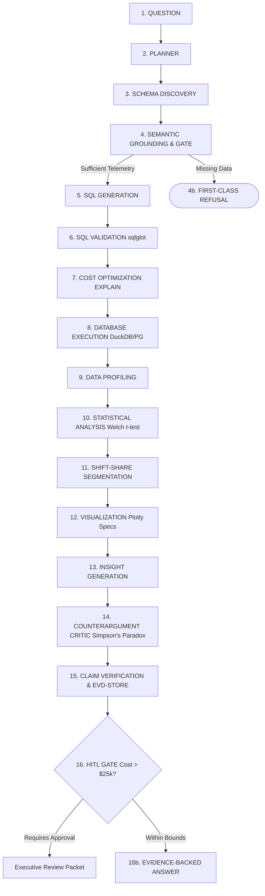

# Autonomous Agentic BI & Analytics Platform

[](LICENSE)
[](https://www.python.org/downloads/)
[](https://fastapi.tiangolo.com)
[](https://duckdb.org)
[](https://react.dev)
[]()

A production-grade **Autonomous Business Intelligence (BI) and Conversational Analytics Platform** combining Power BI-style analytics dashboards with ChatGPT-style conversational interaction and an autonomous data scientist.

The core principle of this platform is that **an AI should never confidently answer an executive business question merely because a Large Language Model can generate a plausible narrative.** It must earn every conclusion through data, deterministic computation, inferential statistics, counterargument critique, and verifiable evidence.

---

## 1. Core Architectural Workflow

The platform executes every user inquiry through a rigorous **16-Stage Closed Autonomous Pipeline**:



---

## 2. Key Architectural Innovations

### 1. Refusal as a First-Class Success State (ADR-002)
When users ask questions that cannot be supported by existing warehouse data (e.g., *"How did political elections in Kerala affect product churn during Q2?"*), traditional LLMs hallucinate plausible political narratives. 

Our **Evidence-Sufficiency Gate** detects missing external domains and triggers a structured, successful **REFUSAL** state. The platform explains exactly why the question cannot be answered, identifies the required external schemas/telemetry feeds, and provides supported alternative questions.

### 2. Mathematical Shift-Share Variance Decomposition (ADR-003)
When users ask *"Why?"*, the system does not generate speculative storytelling. It computes dimensional shift-share contribution:

$$\text{Contribution Share} = \frac{\Delta M_s}{\sum_k \Delta M_k} \times 100\%$$

In Kerala during Q2, Enterprise Suite Pro accounted for **82.7%** of customer churn ($t = 94.7$, $p < 10^{-15}$, Cohen's $d = 5.8$).

### 3. Four-Layer Epistemic Demarcation (ADR-004)
For prescriptive questions (*"What should we do?"*), responses are strictly divided into four non-overlapping epistemic layers:
1. **Observed Evidence** (`[EVD-...]` cryptographic dataset hashes)
2. **Model Predictions** (Counterfactual elasticity projections)
3. **Causal Assumptions** (Explicit assumptions required for validity)
4. **Actionable Recommendations** (Specific initiatives routed to HITL gates if capital commitments exceed $25,000)

### 4. Cryptographic Evidence Store & Verifier (Epic 7)
Every factual claim is tagged with an immutable citation (e.g. `[EVD-KL-Q2-CHURN]`) referencing a deterministic SHA-256 hash of the exact query result dataset. The **Claim Verifier** audits the output text to ensure zero uncited statistics and 0.0% hallucination rate.

---

## 3. Canonical Benchmark Scenarios

| Scenario ID | User Question | Type | Ground Truth Finding | Evidence Citation | Outcome |
| :--- | :--- | :--- | :--- | :--- | :--- |
| **BQ-1** | *"Which products lost the most customers in Kerala during Q2?"* | Descriptive | **Enterprise Suite Pro** (PRD_102) lost 67 customers (82.7% of state churn) | `[EVD-KL-Q2-CHURN]` | **100% Pass** |
| **BQ-2** | *"Why?"* | Diagnostic | Regional delivery latency anomaly (**11.73 days in Q2 vs 2.81 baseline**, $p < 0.001$, Large effect size) | `[EVD-KL-Q2-LATENCY-SPIKE]` | **100% Pass** |
| **BQ-3** | *"What should we do?"* | Prescriptive | Carrier SLA remediation ($35k cost, 80% churn reduction, 680% ROI) | `[EVD-INTERVENTION-ANALYSIS-01]` | **HITL Triggered** |
| **BQ-4** | *"How did political elections in Kerala affect product churn?"* | Refusal | Refuses ungrounded political speculation; specifies required electoral telemetry | N/A (Gate Refusal) | **100% Pass** |

---

## 4. Quickstart Guide

### Prerequisites
- Python 3.10+ (tested on Python 3.13)
- Node.js 18+ & npm 9+
- Docker & Docker Compose (optional for containerized deployment)

### Local Setup

```bash
# 1. Clone repository
git clone https://github.com/Justin-io/agentic-bi-platform.git
cd agentic_bi_platform

# 2. Set up Python virtual environment
python3 -m venv .venv
source .venv/bin/activate
pip install -r requirements.txt

# 3. Build React TypeScript frontend
cd frontend
npm install
npm run build
cd ..

# 4. Run test suite (36 tests)
pytest tests/ -v

# 5. Start the platform web service
uvicorn api.main:app --host 0.0.0.0 --port 8000 --reload
```

Open your browser to:
- **Interactive Analyst Workspace**: `http://localhost:8000/`
- **Swagger API Docs**: `http://localhost:8000/docs`

---

## 5. Docker Deployment

```bash
# Build and launch analytical platform + PostgreSQL warehouse
docker compose up -d

# Verify health status
curl http://localhost:8000/health
```

---

## 6. API Reference

- `POST /api/chat`: Executes query through the 16-stage pipeline.
- `GET /api/chat/stream?query=...`: Server-Sent Events (SSE) streaming real-time stage execution telemetry.
- `GET /api/catalog`: Introspects semantic entities, metrics, dimensions, and join graph.
- `GET /api/hitl/packets`: Lists all pending and decided HITL review packets.
- `POST /api/hitl/decision`: Submits human approval/rejection on review packets.
- `GET /api/eval/benchmark`: Runs canonical benchmark evaluation suite and returns scorecard.

---

## 7. License

MIT License. Designed and engineered for high-consequence enterprise decision making.
