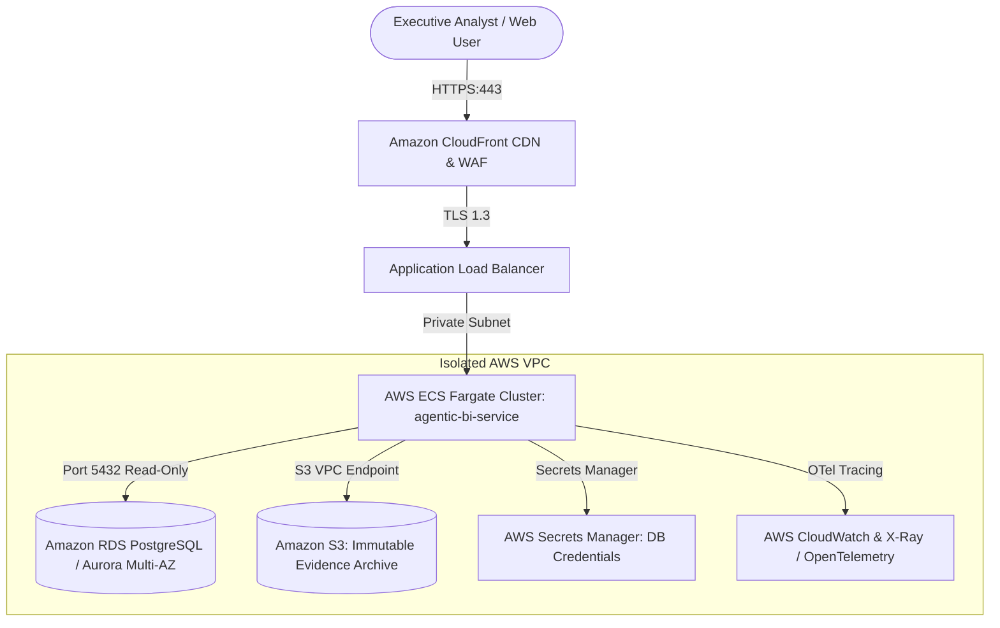

# Enterprise AWS Production Deployment Guide

This guide details how to deploy the **Autonomous Agentic BI & Analytics Platform** in a production-ready, highly available AWS environment.

---

## 1. Cloud Architecture Overview



---

## 2. Infrastructure Components

1. **Amazon ECS (Elastic Container Service) on AWS Fargate**:
   - Serverless container orchestration running the multi-stage Docker container (`Dockerfile`).
   - Auto-scaling based on CPU/Memory and concurrency metrics (min 2 tasks, max 10 tasks across distinct Availability Zones).
2. **Amazon RDS for PostgreSQL (or Amazon Redshift)**:
   - High-throughput analytical warehouse with Multi-AZ automated replication.
   - Dedicated read-only database role (`analyst_ro`) preventing any mutating SQL.
3. **Amazon S3 (Evidence Store)**:
   - Versioned, object-locked bucket storing immutable evidence snapshots and cryptographic SHA-256 result datasets for regulatory compliance.
4. **AWS Application Load Balancer (ALB)**:
   - SSL termination, HTTP/2 and SSE (Server-Sent Events) streaming support (`idle_timeout = 300`).
   - Integrated with AWS WAF for rate limiting and SQL injection protection.

---

## 3. Database Security & Read-Only Hardening

To enforce the platform's non-mutating analytical guarantees at the database engine level, configure a dedicated read-only role:

```sql
-- Create read-only role
CREATE ROLE bi_analyst_ro WITH LOGIN PASSWORD '${SECURE_PASSWORD}';

-- Grant connection and usage
GRANT CONNECT ON DATABASE agentic_bi TO bi_analyst_ro;
GRANT USAGE ON SCHEMA public TO bi_analyst_ro;

-- Grant SELECT only
GRANT SELECT ON ALL TABLES IN SCHEMA public TO bi_analyst_ro;
ALTER DEFAULT PRIVILEGES IN SCHEMA public GRANT SELECT ON TABLES TO bi_analyst_ro;

-- Prevent temporary table creation and mutations
REVOKE CREATE ON SCHEMA public FROM bi_analyst_ro;
```

---

## 4. Terraform Deployment Blueprint

Deploy the ECS cluster, task definition, and ALB using Terraform:

```hcl
module "ecs_fargate" {
  source  = "terraform-aws-modules/ecs/aws//modules/service"
  version = "~> 5.0"

  name        = "agentic-bi-platform"
  cluster_arn = aws_ecs_cluster.main.arn

  cpu    = 2048
  memory = 4096

  container_definitions = {
    agentic_bi = {
      image  = "${aws_ecr_repository.bi_platform.repository_url}:v1.0.0"
      cpu    = 2048
      memory = 4096
      essential = true

      port_mappings = [
        {
          containerPort = 8000
          hostPort      = 8000
          protocol      = "tcp"
        }
      ]

      environment = [
        { name = "ENVIRONMENT", value = "production" },
        { name = "WAREHOUSE_ENGINE", value = "postgres" }
      ]

      secrets = [
        {
          name      = "DATABASE_URL"
          valueFrom = aws_secretsmanager_secret.db_credentials.arn
        }
      ]

      health_check = {
        command     = ["CMD-SHELL", "curl -f http://localhost:8000/health || exit 1"]
        interval    = 30
        timeout     = 5
        retries     = 3
        startPeriod = 15
      }
    }
  }

  load_balancer = {
    service = {
      target_group_arn = aws_lb_target_group.bi_tg.arn
      container_name   = "agentic_bi"
      container_port   = 8000
    }
  }

  subnet_ids = module.vpc.private_subnets
}
```

---

## 5. Health Monitoring & Observability

- **Health Check Endpoint**: `/health` (verifies database connectivity and warehouse latency).
- **OpenTelemetry Export**: Configure `OTEL_EXPORTER_OTLP_ENDPOINT` to stream 16-stage pipeline traces directly to AWS CloudWatch X-Ray or Datadog.
- **Alerting Thresholds**:
  - Task Error Rate > 1% (5 min window)
  - 16-Stage Pipeline Latency > 3.0s (P95)
  - Failed Evidence Verifications > 0 (immediate P1 alert)
